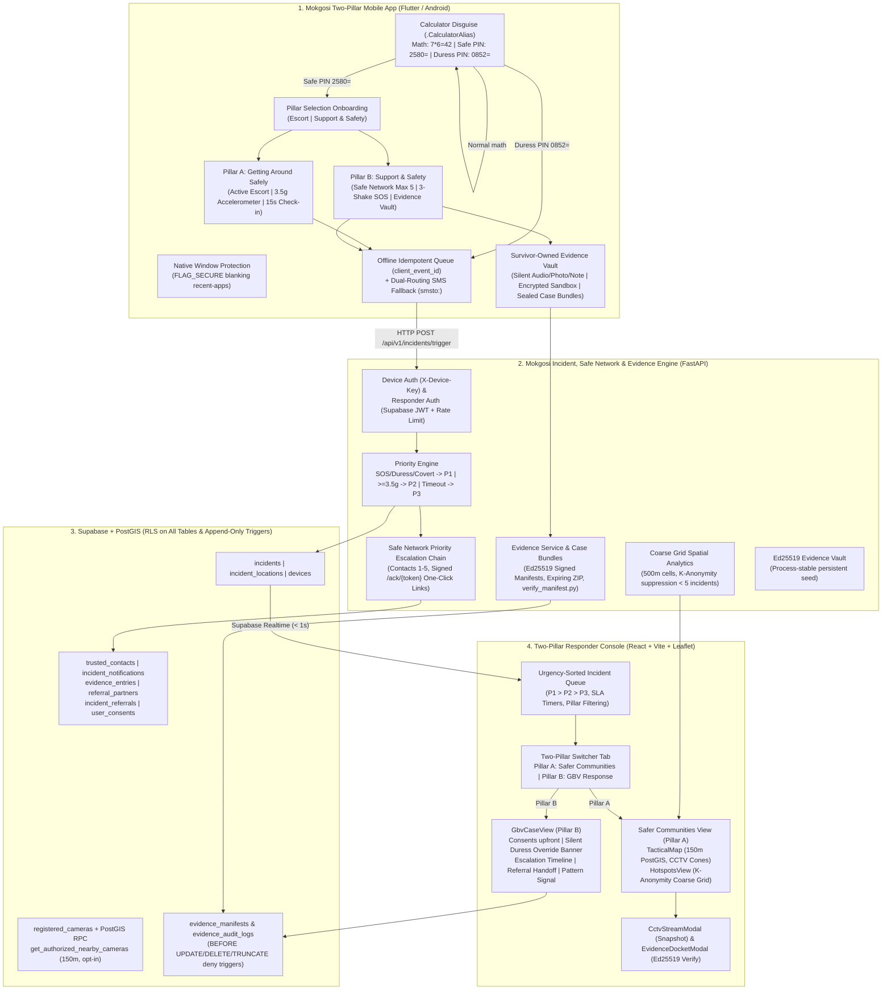

# MOKGOSI — Two-Pillar Architecture & Data-Flow Specification (v3.0)

## 1. High-Level Two-Pillar Architecture Diagram

---

## 2. Separation of Responsibilities & Core Invariants

1. **Independent Dual-Routing (`Route 1` vs `Route 2`):**
   - Safe network trusted contact dispatch (`Route 1`) and Command Center incident recording (`Route 2`) operate on completely isolated, decoupled paths. Neither path gates, blocks, or cancels the other.
   - Even if the database fails, the trusted contact notification still fires.
2. **Strict Covert Standards (Pillar B):**
   - Covert SOS triggers (`COVERT_SOS`, `SHAKE_SOS`, `DURESS_PIN`) generate **zero sound, zero vibration, zero toast notifications, and zero on-screen alerts**.
   - Launcher label and icon display a working calculator (`.CalculatorAlias`); recent-apps task switcher is blanked via native `FLAG_SECURE`.
   - Outbound responder calls/texts are strictly blocked by system policy for covert alerts.
3. **Survivor Data Sovereignty & Evidence Mode:**
   - Evidence media is stored in an encrypted local sandbox and backed up to a private storage bucket.
   - No evidence is shared automatically with responders. The survivor explicitly selects entries to generate a signed forensic case bundle ZIP with an expiring download token (`/api/v1/evidence-bundles/{token}`).
4. **Honest Referral Handoffs:**
   - Referral partner records in `referral_partners` are strictly flagged `verified = false` until formal bilateral operational agreements are signed. Unverified numbers are never shown as callable contacts to survivors.
5. **K-Anonymity Spatial Analytics:**
   - The community analytics endpoint aggregates incidents into coarse ~500m grid cells and suppresses any cell with fewer than 5 incidents (or fewer than 10 GBV incidents) to guarantee anonymity.
6. **Ed25519 Cryptographic Integrity:**
   - All manifests are signed using persistent Ed25519 keys over canonical sorted JSON. Tampered payloads fail verification both in-app and via standalone offline Python scripts (`verify_manifest.py`).
