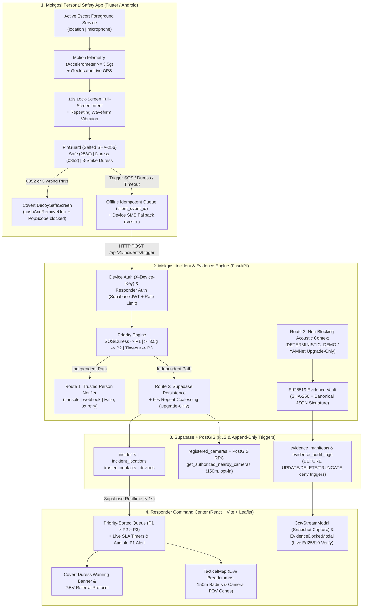

# MOKGOSI — System Architecture & Data-Flow Specification (v2.1)

## 1. High-Level Architecture Diagram

---

## 2. Separation of Responsibilities & Core Invariants

1. **Independent Dual-Routing (`Route 1` vs `Route 2`):**
   - `trigger_incident` in [`mokgosi-backend/main.py`](../mokgosi-backend/main.py) schedules Trusted Person notification (`Route 1`) even if Supabase is unreachable (`HTTP 202 ACCEPTED`, `persistence_state: "UNAVAILABLE"`) or if the `incidents` insert fails (`persistence_state: "FAILED"`).
   - Conversely, if the external SMS/webhook provider fails after 3 retries (`Route 1`), the incident remains active in Supabase (`Route 2`) and `TRUSTED_CONTACT_FAILED` is recorded in `evidence_audit_logs`.
   - PostGIS camera matching (`get_authorized_nearby_cameras`) and audit log inserts are best-effort and never roll back or fail an active incident.
2. **Idempotency & 60-Second Coalescing:**
   - Every mobile alert generates a UUID v4 `client_event_id` persisted in the mobile offline queue before transmission.
   - Retrying the same `client_event_id` returns the existing incident (`200 OK`).
   - Subsequent triggers from the same `user_id` within 60 seconds coalesce onto the open incident (`REPEAT_TRIGGER`), upgrading priority if the new trigger is higher and never downgrading.
3. **Strict Responder Lifecycle State Machine:**
   - Enforces `CREATED → ACKNOWLEDGED → ASSIGNED → DISPATCHED → RESOLVED` (`409 Conflict` on any skipped or backward transition) and records `acknowledged_by/at`, `assigned_to/at`, `dispatched_at`, and `resolved_at` using the verified Supabase Auth responder identity.
4. **Tamper-Evident Cryptographic Evidence Vault:**
   - Requires a persistent 32-byte `ED25519_PRIVATE_KEY_SEED` at process startup (refusing to generate ephemeral keys).
   - Every consenting audio clip (`AUDIO_CONTEXT_CLIP`) and authorized camera frame (`AUTHORIZED_CCTV_FRAME`) is hashed (`SHA-256`), signed (`Ed25519`) over canonical sorted JSON, protected by PostgreSQL append-only triggers, and verifiable both in-app (`/api/v1/evidence/verify`) and offline (`python verify_manifest.py`).

